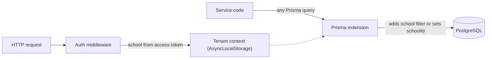

# Multi-tenant e-learning and school platform

- **Company:** Exceed IT Systems
- **Role:** Main developer: backend, web frontend, and mobile app
- **When:** 2026 – present
- **Stack:** TypeScript, Express, PostgreSQL, Prisma, React, Vite, Tailwind CSS, Expo (React Native), Redis, Server-Sent Events

**In short:** One platform serves many schools from a single backend, database, and sign-in. It covers online courses, school records, and campus services such as meal cards, dormitories, and the clinic. The main challenge was keeping each school's data separate without relying on every developer to remember a filter in every query.

## The problem

A school needs online courses, student records, and daily campus services. These usually live in separate systems, each with its own login and its own copy of every student. Running one deployment per school multiplies servers and upgrades, but putting many schools in one database risks one school seeing another school's data.

## What I built

- **Learning (LMS):** courses, modules, lessons, quizzes, assignments, certificates, forums, and course chat.
- **School management:** moving a legacy single-school system into the platform, starting with student records, academic years, semesters, classes, sections, curriculum, and teachers (in progress).
- **Campus services:** an Expo app that meal-card, dormitory, and clinic staff use to scan student QR cards. The same app runs on phones and, through react-native-web, in the browser.
- **One sign-in:** students, teachers, admins, and campus staff use the same login, and each role lands on its own home page. In the browser the campus app reuses the LMS session; on phones the refresh token is kept in secure storage.
- **One student record:** a single `Student` record is the source of truth for the LMS account, school records, and the QR card, so there is never a second copy to keep in sync.

## How tenant isolation works

Each school is a tenant. Every request runs inside a tenant context held in Node's `AsyncLocalStorage`:

- a signed-in user gets their own school, taken from the access token and re-checked on each request;
- a signed-out visitor on a school's own domain gets that school.

A Prisma client extension sees every query. For reads, updates, and deletes it adds the school filter; when a school-owned record is created it sets the school. One map describes how each of about 50 tenant-owned models reaches its school, either directly or through a parent: a quiz answer belongs to an attempt, which belongs to a course, which belongs to a school.

**Why:** when each service adds its own filter, isolation depends on every developer remembering it in every query. Here a new query is scoped by default.

**Trade-offs:**

- The filter is appended with `AND`, so it never overwrites the caller's conditions and lookups by unique key still work.
- Raw SQL bypasses Prisma, so the few raw analytics queries filter by school explicitly.
- Superadmin tools, seed scripts, and background jobs run without a tenant context and are not filtered, so they have to be written with that in mind.

## Sessions and security

- Short-lived access tokens with rotating refresh tokens. Refresh tokens are stored only as hashes.
- Each sign-in starts a token family. If an already-used refresh token is presented again, which suggests it was stolen, the whole family is revoked and the event is logged.
- Separate rate limits for sign-in, general API use, and media access tokens. The last one stops bulk downloading of lesson videos. Limit counters are kept in Redis, so they hold across server instances.
- Permissions belong to each account and are checked on every route; the admin menu shows only the pages an account can open. Admins cannot grant a permission they do not hold, and every change is written to the audit log.

## Realtime course chat

Chat uses Server-Sent Events. With Redis configured, events fan out through Redis pub/sub and online presence is kept in a Redis sorted set whose entries expire (30-second heartbeat, 90-second expiry), so every server instance sees the same state. Without Redis, the same code runs on a single instance.

## Testing and delivery

- Vitest unit and integration tests, including the refresh-token flow, and k6 load tests.
- GitHub Actions CI runs the tests and the build. A deploy workflow on a self-hosted runner installs dependencies, applies database migrations, and reloads the app with PM2.
