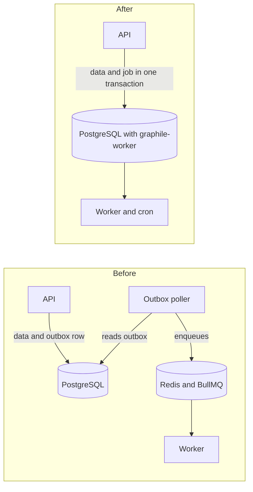

# Help desk / ITSM platform

- **Company:** Exceed IT Systems
- **Role:** Software Engineer, one of two developers. The core ticketing, SLA, and sign-in features were already in place when I started on this codebase in August 2026. This page covers my part.
- **When:** August 2026 – present
- **Stack:** TypeScript, Express, PostgreSQL, Prisma, graphile-worker, React, TanStack Query, Zod

**In short:** A help desk for support teams that serve many customer organizations. Customers raise and track requests in a portal; agents and engineers triage, escalate, and resolve them against SLA targets. I moved the background jobs from Redis into PostgreSQL, reorganized the codebase into feature modules, standardized validation and data fetching, and added knowledge suggestions that can answer a customer before a ticket is filed.

## The platform

- **Customer portal:** raise and track tickets, approve requests, read published knowledge articles, and see SLA performance.
- **Provider workspace:** L1/L2/L3 support tiers, escalations, problem and known-error records, defects, SLA policies with business hours and holidays, and major-incident coordination.
- Each customer organization's data is kept separate.

## 1. Background jobs: from BullMQ and Redis to PostgreSQL

**Before:** jobs ran on BullMQ, which needs Redis. Redis cannot take part in a PostgreSQL transaction, so the code kept its own outbox table, a poller that dispatched jobs from it, and a `setInterval` scheduler for recurring scans.

**What I did:** moved the queue to graphile-worker, which stores jobs in PostgreSQL.

- A job is enqueued in the same transaction as the data change that caused it: both are saved, or neither is. That made the hand-written outbox, poller, and scheduler unnecessary, so I deleted them.
- The two recurring scans became cron entries on the worker.
- Job handlers moved out of one central `switch` into files owned by each feature, combined through a typed handler map. A job type without a handler is now a compile error instead of a runtime failure.
- Redis is no longer needed for jobs. Deployment installs the queue's schema right after the database migrations, and CI smoke-tests it.

## 2. Knowledge suggestions that deflect tickets

While someone fills in a new ticket, the form suggests up to three answers that may solve the problem before it is submitted.

- **Sources:** published knowledge-base articles and resolved tickets. For a resolved ticket, the answer is the latest reply from support staff that the customer could see.
- **Embeddings:** a self-hosted Ollama model when one is configured; otherwise a built-in hashing embedder with no dependencies, so the feature works without any AI service. Each vector records which model produced it, and only vectors from the active model are compared.
- **Ranking:** cosine similarity with a minimum score. At equal similarity, curated articles rank above past tickets.
- **Isolation:** candidates are filtered by organization and visibility in the database query, before any similarity is calculated, never afterwards.
- **Indexing** runs in the background, so a failure there never blocks saving an article or resolving a ticket.

## 3. Codebase structure and validation

- Reorganized the backend from layer folders into feature modules, each with its own routes, controllers, services, and tests; moved the frontend's pages into feature modules too; and split the Prisma schema into smaller files.
- Moved request validation to Zod schemas across 17 feature modules, including tickets, SLA, sign-in and SSO, integrations, problems, and releases.
- Moved the frontend's server data onto TanStack Query and deleted the hand-written module-level caches for tickets and notifications.

## 4. Product features

- **Service catalog:** request forms with structured fields for ERP modules, multi-select fields, request templates, a portal request page, and services modeled either as modular systems or as standalone services.
- **Dashboards:** an admin dashboard that fits on one screen, with drill-downs, SLA tabs, date-range presets, a customer-satisfaction trend, and PDF export; response and resolution metrics for providers; and charts on the customer portal.
- **Sign-in:** replaced the choice between a customer portal and a staff portal with a single login form.
