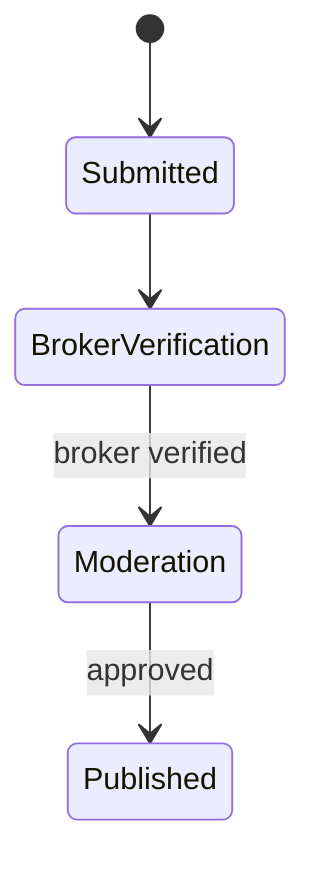

# Lumina Houses: real-estate marketplace

- **Company:** Vionet (formerly Teleport Technologies PLC)
- **Role:** Full-Stack Engineer (internship)
- **When:** September – December 2025
- **Stack:** NestJS, Angular, TypeScript, PostgreSQL, TypeORM, Socket.IO, Cloudinary

**In short:** Finding a house in Ethiopia often means dealing with brokers who list properties they do not represent. I designed the listing lifecycle so that only verified brokers can publish, and wrote the test suite for sign-in and the critical user paths.

## The problem

- Brokers list properties they do not represent.
- Owners cannot tell serious buyers from time-wasters.
- Buyers pay fees for houses that were never available.

A marketplace where anyone can publish simply moves the same problem online.

## What I built

### Listing lifecycle

Every listing goes through fixed stages: submission, broker verification, moderation, and publication. A listing can reach publication only after verification and moderation, so an unverified broker cannot publish. Fraudulent listings are kept off the marketplace by design, not removed after someone reports them.

### Tests

I wrote the test suite for authentication and the critical user paths: unit and integration tests, k6 load tests, and Playwright end-to-end tests. Regressions are caught before release, not by users.

### Across the stack

Features in the NestJS backend and Angular frontend, real-time updates with Socket.IO, and media uploads with Cloudinary. I also took part in code reviews and release readiness.

## What I learned

The code could stop unverified brokers from publishing, but much of the problem sat outside the code: how brokers are verified, how disputes are handled, and how a platform earns the trust of people who have been cheated before.
